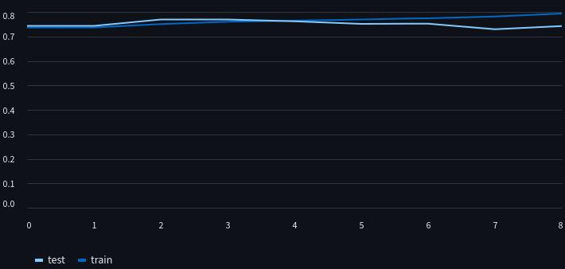

# Netflix Churn with decision tree

In this project I have applied Decision tree from scratch in [netflix-churn](https://www.kaggle.com/datasets/abdulwadood11220/netflix-customer-churn-dataset) data set in kaggle and showed the preview of model in streamlit app. This markdown is just the preview of the project and how I made this. I have given more details in my [notes](https://github.com/gitbhusalhubpramish/ml-notes/tree/main/0.004%20decision-tree) about decision tree

This is what the accuracy of model in training and test looks like in defferent depth. I have rendered 9 models in the [preview](https://netflix-churn-decision-tree.streamlit.app/)

## Small intro to Decision Tree

Decision Tree is a supervised meachine learning algorithm where it splits data using a treshold on and on untill it reaches to leaf(prediction). It is usually classification model but sometimes it can be used as regression model thouough I have used classification.

## Feature

This project was made by me to understand Decision from scratch so it has decision tree applied from scratch. But also:

- Decision tree from scratch.
- Decision tree visulization
- streamlit cache

## Tech-Stack

This project uses python liberies used for datascience - visulization, calculation and data manipulation. I've used:

- Numpy for calculation
- streamlit and graphviz for data visulization and preview
- Pandas for data manipulation
- sk-learn for datasplit and accuracy counting

## Work-flow

The workflow of the project looks like this:

- **Data fetch:** Data is fetched from kaggle dataset through it's API.
- **Data Split:** Here the data is splited into 2(4) parts for training and testing for each with x and y.
- **Gini Impurity and best split:** The gini impurity is calculated in every possible trashold, then split with best(lowest) score is choosen.

$$
split score = \frac{n_{left}}{n_{total}} Gini(left) + \frac{n_{right}}{n_{left}} Gini(right)
$$
- **Prediction leaf:** When there's no possible treshold or data is very pure or if the model reached it's maximum depth we make a preciditon leaf. It takes the mode of the data.

- **repeat:** repeat to calculate gini impurity, split, and build predictin leaf untill it reaches the max depth. the last node is always a prediction leaf.

- **Running/Testing/Plotting:** We run the data through testing data and find accuracy. Also I have ploted all the decision tree too - bonus download button for every tree.

## So, What did I learn?

I had made this project to learn Decision tree from scratch. Of Cource I had learnt that:) but other stuff like:

- Decision Tree
- Classification
- Gini impurity
- tree plotting

## Some extra info...

I have been learning Meachine Learning from scratch so I make notes and make at least one project for each algorithm. I have writtern a jupiter notebook to plan and make this work them I make a python script file with the help of streamlit so that I can host and support hackclub. Most of the progress of learning is in my notebook(coding time only) while I struggle a lot to research about the algo too. While shifting to another technology like streamlit and learning that took my a lot of time too. I made this project to learn so it has very less QI applied.
